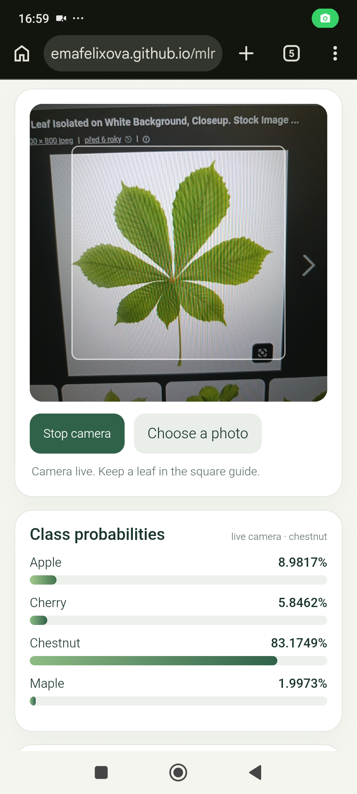
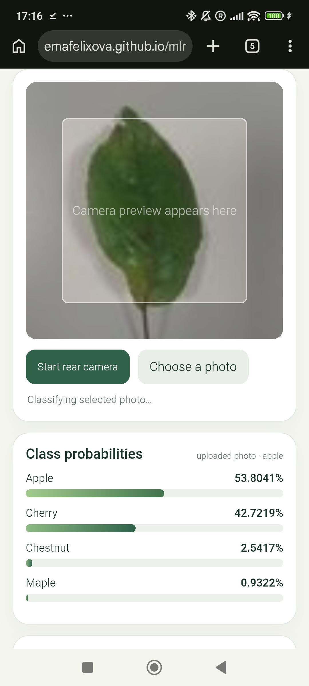

# Leaf classifier review

Review target: the checked-in `index.html`, `leaf_model.onnx`, `model_info.json`, `check_expected.json`, and `check_image.jpg`, plus the supplied `Kopie sešitu ex08_student.ipynb`.

## 1. Runs on a phone

**What I did:** Opened the public Pages URL, `https://emafelixova.github.io/mlr-ex08/`, and inspected the camera flow in `index.html`. The supplied phone screenshot shows the live camera pointed at a leaf image on another screen, with predictions updating.

**What I found:** The screenshot shows the live camera active and these probabilities: apple 8.9817%, cherry 5.8462%, chestnut 83.1749%, and maple 1.9973%. The top prediction is chestnut. The screenshot demonstrates live camera inference on a phone.

**What was fixed:** No code fix was needed; the phone screenshot confirms the rear-camera flow and live predictions work for this test.

**Evidence:**

## 2. Check image probabilities

**What I did:** Reviewed your screenshot after you selected `check_image.jpg` on the live page. The page reports `uploaded photo` and displays the four probabilities below.

**What I found:** The page's displayed results agree with `check_expected.json` to three decimals. The page shows percentages; the probabilities below convert those displayed values to 0–1. Its display rounds to four decimal places in percent, so the chestnut value differs in the sixth decimal as shown.

| Class | Page upload probability | `check_expected.json` | To three decimals |
| --- | ---: | ---: | --- |
| apple | 0.538041 | 0.538040578 | 0.538 = 0.538 |
| cherry | 0.427219 | 0.427219361 | 0.427 = 0.427 |
| chestnut | 0.025417 | 0.025417605 | 0.025 = 0.025 |
| maple | 0.009322 | 0.009322453 | 0.009 = 0.009 |

**What was fixed:** No code change was needed. The upload test is now verified from the supplied screenshot.

## 3. Preprocessing matches the model and notebook

**What I did:** Read `cropDraw` and `classify` in `index.html`, `model_info.json`, and the Task 2 data and transform cells in the supplied notebook (cells 37, 40, and 49).

**What I found:** The page takes a centered square from each frame or uploaded image, resizes it to `input_size` (96 × 96), reads canvas RGB bytes, divides each channel by 255, and standardizes R, G, and B using the `mean` and `std` loaded from `model_info.json`. It stores the channels in separate contiguous planes in R, G, B order, then creates a float tensor with shape `[1, 3, 96, 96]`.

The notebook says the Task 2 training images were center-cropped and resized to 96 × 96 when the dataset was prepared. Its Task 2 transform is `ToTensor()` followed by `Normalize(mean, std)`: `ToTensor()` scales RGB bytes to 0–1 and changes HWC to CHW. The notebook's exported metadata uses the same input size, class list, mean, and standard deviation. The page's inference preprocessing therefore matches the Task 2 model pipeline. The notebook's random crop, flips, and rotation belong to the separate Task 3 training augmentation and are not applied at inference.

**What was fixed:** No preprocessing change was needed; the inspected page and metadata agree with the notebook's inference-time transform.

## 4. Image privacy and page requests

**What I did:** Inspected the page's network references and image-handling code.

**What I found:** Camera frames and selected photos are drawn to a browser canvas and passed to ONNX Runtime Web in the browser. The page has no image-upload endpoint or remote inference call, so it does not send the image to the model host or CDN. The page requests:

- the GitHub Pages host for the page, `model_info.json`, and `leaf_model.onnx`;
- the jsDelivr CDN for `ort.min.js`;
- the jsDelivr CDN for ONNX Runtime WebAssembly assets so inference can run in the browser.

The QR code is embedded in the HTML as a data image and makes no QR-service request. These requests transfer the page, model metadata, model, and runtime code; they do not contain the camera frame or selected photo. The hosting and CDN services still receive ordinary page and asset requests from the browser.

**What was fixed:** No image-transfer code was found that needed fixing. The QR was embedded directly in the page, so it does not rely on a third-party QR-image service.
